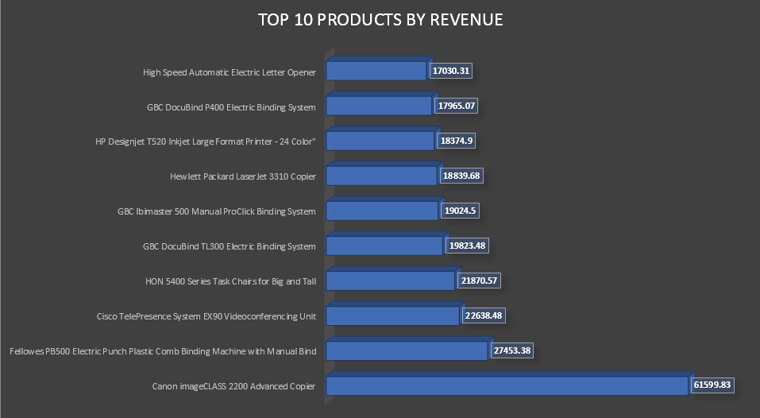
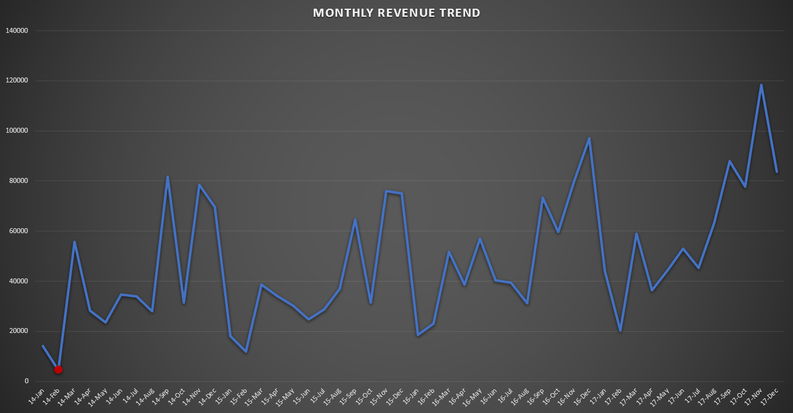

# E-commerce Sales Analysis

A MySQL project answering three business questions on 9,994 rows of retail sales data (2014–2017).

## The business questions

1. What are our **top 10 products by revenue**?
2. Which was our **slowest month**?
3. Do **repeat customers** spend more than **one-time customers**?

## The data

- **Source:** [Superstore Sales dataset (Kaggle)](https://www.kaggle.com/datasets/vivek468/superstore-dataset-final)
- **Size:** 9,994 orders, 793 customers, Jan 2014 – Dec 2017
- **Grain:** one row per product per order
- The `data/` folder holds the three query-result exports (not the raw data — download it from the link above).

## What I did

1. **Loaded the data** with `LOAD DATA INFILE` (the Table Import Wizard kept stalling — the direct-load method finished in seconds).
2. **Fixed an encoding mismatch** — the CSV was saved in Windows latin1; one product name broke the UTF-8 import until I declared `CHARACTER SET latin1`.
3. **Standardized column names** to `snake_case` (`Customer ID` → `customer_id`) so queries don't need backticks.
4. **Built a real DATE column** from the text dates with `STR_TO_DATE` — the text format made every date function return NULL until this was done.
5. **Wrote the three analysis queries** (`sql/02_analysis_queries.sql`), verified row counts at every step.

## Findings

### 1. Top 10 products by revenue

The **Canon imageCLASS 2200 Advanced Copier** leads at **$61,599.83** — more than double the #2 product (Fellowes PB500 at $27,453.38). Office machines dominate the top of the list.

### 2. Slowest month — and a seasonal pattern

- **Slowest month: February 2014** at **$4,519.92** — less than a tenth of the ~$47,858 monthly average.
- The trend reveals a clear **seasonal pattern**: revenue spikes every November–December (holiday season) and dips in early Q1.
- Overall direction is **upward** — Dec 2017 closed near $84k, roughly double Dec 2014.

### 3. Repeat customers spend ~7x more

| Customer type | Customers | Avg. lifetime spend |
|---|---|---|
| Repeat | 781 | $2,934.74 |
| One-time | 12 | $430.64 |

**781 of 793 customers (98%) are repeat buyers**, and they spend **$2,934.74** on average — nearly **7x** the $430.64 of one-time buyers. This is a relationship business: almost nobody buys just once, and keeping a customer is worth far more than finding a new one.

## Files

- `sql/01_data_setup.sql` — table creation, data load, column renames, date conversion
- `sql/02_analysis_queries.sql` — the three analysis queries
- `data/` — query result exports (CSV)
- `images/` — charts

## Tools

MySQL 8.0 (MySQL Workbench) · Excel (charts)
