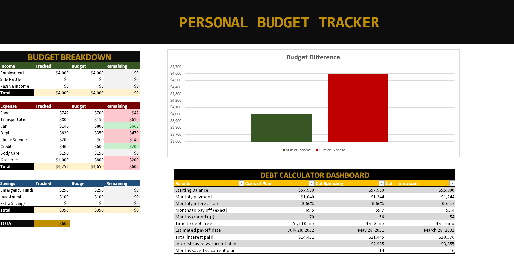

# Personal Budget Tracker

An Excel tracker for monthly income, expenses, and remaining budget.

## What it does

- **Budget breakdown** — income vs. expenses by category (Employment, Side Hustle, Passive Income, Food, Transportation, …)
- **Dept calculator** — debt tracking alongside the budget
- **Remaining budget** — what's left after expenses, updated as you log

## Sheets

| Sheet | Contents |
|---|---|
| `Dashboard` | Budget overview: income, tracked spending, remaining |
| `Budget Category` | Category definitions and allocations |
| `Dept Calculator` | Debt payoff calculations |

## Techniques

Dashboard design · category-based budgeting · formula-driven summaries

## View it

Open `PERSONAL_BUDGET_TRACKER.xlsx` — GitHub previews spreadsheets right in the browser, no download needed.

## Tools

Excel
