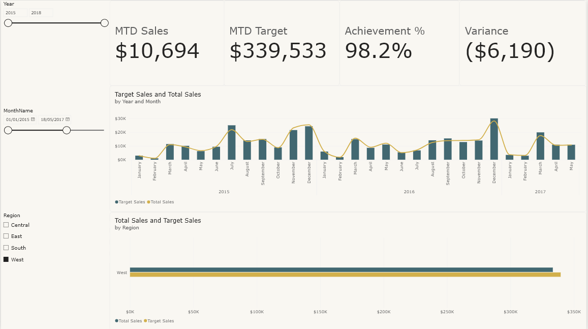

# 01 — Sales Performance Dashboard

> **Finished dashboard included:** `Sales_Performance_Dashboard.pbix` — open it in Power BI Desktop. The kit below (prepared data, data model, written-out DAX measures, click-by-click build guide) shows how it was built.

## Business question

> "One dashboard I can check every Monday morning: are we ahead or behind target this month, and which region needs attention?"

This dashboard answers two things at a glance:
1. **This month:** actual sales vs target, achievement %, and variance.
2. **Attention:** which regions are below target, so Monday's follow-up has a name on it.

## Data

| File | Rows | What it is |
|---|---|---|
| `data/superstore.csv` | 10,800 (9,994 clean) | **Real** Superstore order data, 2015–2018. Columns: Row ID, Order ID, Order Date, Ship Date, Ship Mode, Customer ID, Customer Name, Segment, Country, City, State, Postal Code, Region, Product ID, Category, Sub-Category, Product Name, Sales, Quantity, Discount, Profit. |
| `data/SAMPLE_Targets_by_Region_Month.csv` | 192 | **SAMPLE / illustrative data.** Monthly sales target per region (4 regions × 48 months). Targets are hypothetical — they were generated by scaling real monthly sales by a factor of 0.90–1.15 so the dashboard shows a realistic mix of months above and below target. Do not present these targets as real company figures. |
| `data/DimCalendar.csv` | 48 | Month dimension: one row per month, 2015-01 to 2018-12. Columns: MonthStart, Year, Month, MonthName. |
| `data/DimRegion.csv` | 4 | Region dimension: Central, East, South, West. |

### Known quirks in the real file (handled in Power Query, see build guide)
- **806 embedded junk rows:** the raw export repeats header rows inside the data (rows where `Row ID` = "Person" and every other column is blank). Filter these out.
- **Dates are text** (`Order Date` like `11/8/2017`, month/day/year) — convert to Date type.
- **Sales / Profit / Quantity / Discount import as text** — convert to numbers.
- **11 rows are missing Postal Code** — harmless for this dashboard; leave them blank.

## Data model

See `model.md`. In short, this is a small **star schema**:

- Dimensions: `Calendar` (MonthStart) and `Region` (Region).
- Facts: `Sales` (one row per order line) and `Targets` (one row per region-month).
- Relationships (all single-direction, dimension → fact):
  - `Calendar[MonthStart]` → `Sales[MonthStart]`
  - `Calendar[MonthStart]` → `Targets[MonthStart]`
  - `Region[Region]` → `Sales[Region]`
  - `Region[Region]` → `Targets[Region]`

Why two dimensions instead of joining Sales to Targets directly? Both facts share the same calendar and region, so one set of slicers filters both. Actual and target then always compare on the same month and region — which is the whole point of the dashboard.

## DAX

See `dax.md`. The measures you will create:

| Measure | Purpose |
|---|---|
| `Total Sales` | Sum of Sales |
| `Target Sales` | Sum of Target |
| `Achievement %` | Actual ÷ Target |
| `Variance` | Actual − Target (dollars) |
| `MTD Sales` | Month-to-date sales (for the "this month" card) |

## Visuals (what you will build)

1. **KPI cards (top row):** MTD Sales, MTD Target, Achievement %, Variance. Format Achievement % green when ≥ 100%, red when < 100%.
2. **Region breakdown (bar chart):** Actual vs Target by region, with conditional formatting on the bars so any region below target stands out in red.
3. **Monthly trend (line chart):** Actual sales and target by month, so the Monday-morning reader sees whether the gap is widening or closing.
4. **Slicers:** Year, Month, Region — so the "this month" view can be reproduced for any month.

## What you will see when you build it

What you should expect once built: the KPI cards show real Superstore totals (2015–2018 sales total ≈ $2.30M), the region bars show West as the largest region, and the monthly line shows the familiar November/December seasonal peaks. If your totals are wildly different, re-check the Power Query junk-row filter — the 806 embedded header rows are the usual culprit.

## How to build it

Follow `build-guide.md` step by step: import → Power Query cleaning → Model view relationships → DAX measures → visuals → formatting. Estimated time: 45–90 minutes for a first-time builder.
