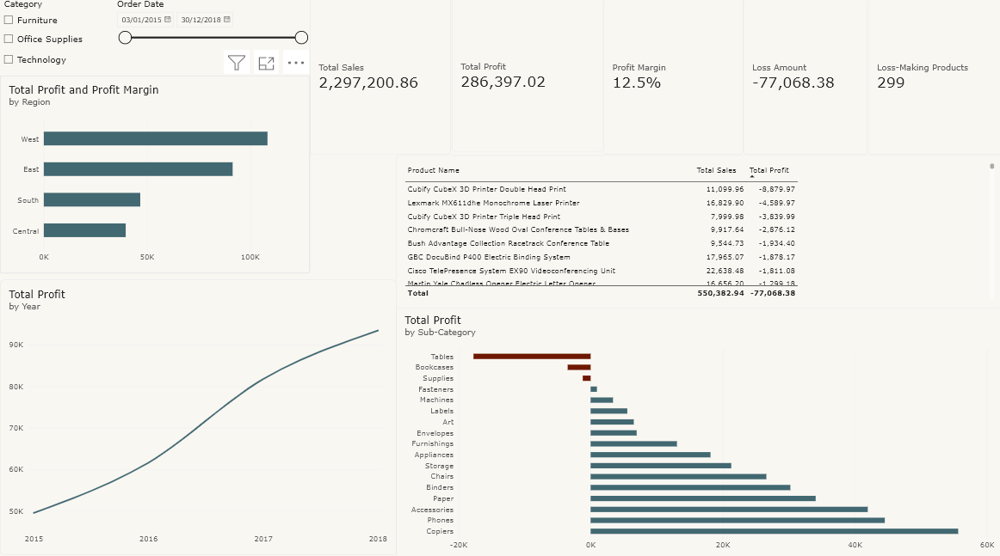

# 05 — Capstone: Where Are We Losing Money?

> **Finished dashboard included:** `Capstone_Where_Are_We_Losing_Money.pbix` — open it in Power BI Desktop. The kit below (prepared data, documented cleaning steps, data model, written-out DAX measures, click-by-click build guide, leadership presentation script) shows how it was built.

## Step 0 — The business question FIRST (before touching any data)

> **"Where are we losing money?"**

This order matters and it is the whole point of a capstone: the question decides what data to keep, what to clean, and what to visualize. Working backward from the question:

- **Keep:** every column that explains profit or loss — Category, Sub-Category, Product Name, Region, Segment, Discount, Sales, Profit, Order Date.
- **Ignore for this question:** Ship Mode, Customer Name, City/State detail (region-level is enough for leadership), Ship Date.
- **The dashboard must answer, in order:** (1) How much money is lost, in total? (2) Where — which categories, sub-categories, regions, products? (3) Why — what pattern connects the losses? (4) What do we do about it?

## Data

| File | Rows | What it is |
|---|---|---|
| `data/superstore.csv` | 10,800 (9,994 clean) | **Real** Superstore order data, 2015–2018. Same file as project 01. |

### The messy bits — found by actually inspecting this file (not guessed)

These are the real issues your Power Query steps will fix, documented in `build-guide.md`:

1. **806 embedded header rows.** The export repeats header rows inside the data (rows where `Row ID` = "Person" and every other column is blank). They must be filtered out, or every total is wrong.
2. **Dates are text.** `Order Date` and `Ship Date` arrive as text in M/D/YYYY form (e.g. `11/8/2017`) and must be converted to Date type.
3. **Numbers are text.** `Sales`, `Quantity`, `Discount`, `Profit` import as text and must be converted to numbers.
4. **11 genuinely missing Postal Codes** in otherwise valid rows. Decision: leave them blank — never invent a postal code.
5. **Duplicate-looking rows are NOT duplicates.** The same `Order ID` appears on many rows because one order contains many products. Deduplicating on Order ID would delete real sales. This is the most dangerous "cleaning" mistake in this dataset.
6. **Negative profit is real data, not an error.** 1,871 rows (18.7%) have negative profit. They are the story, not dirt — do not delete them.

## Data model

See `model.md`. One fact table, `Sales`, no dimensions — deliberately. The capstone's modeling lesson is restraint: a calendar table and a product dimension are both defensible additions, but neither is needed to answer "where are we losing money," so neither is built. (Both are listed as stretch goals.)

## DAX

See `dax.md`. The measures you will create:

| Measure | Purpose |
|---|---|
| `Total Sales` | Sum of Sales |
| `Total Profit` | Sum of Profit |
| `Profit Margin` | Profit ÷ Sales |
| `Loss-Making Products` | Count of products with negative total profit |
| `Loss Amount` | Total profit of loss-making products (a negative number) |

## Visuals (what you will build)

1. **KPI cards:** Total Sales, Total Profit, Profit Margin, Loss Amount.
2. **Profit by sub-category (bar chart):** the loss story in one picture — Tables deep in the red, everything else mostly green.
3. **Profit by region (bar chart):** Central thinnest, West healthiest.
4. **Profit trend (line chart):** profit by month — is the bleeding getting worse or better?
5. **Worst products table:** the specific SKUs losing the most money, with sales and profit side by side.

## The findings (verified from this exact file — use these in your presentation)

- **Overall:** $2,297,201 in sales, $286,397 in profit — a **12.5% margin**.
- **Furniture is the problem category:** 2.5% margin ($18,451 on $742,000), versus Technology 17.4% and Office Supplies 17.0%.
- **Tables lose money outright:** −$17,725 profit on $206,966 sales (−8.6%). Bookcases (−$3,473) and Supplies (−$1,189) also lose. These are the only three loss-making sub-categories.
- **18.7% of order lines lose money** (1,871 of 9,994).
- **Discounting is the mechanism:** order lines with discount ≥ 40% average **−$107.65** profit each; lines with no discount average **+$66.90**.
- **Worst single products:** Cubify CubeX 3D Printer Double Head Print (−$8,880), Lexmark MX611dhe Monochrome Laser Printer (−$4,590), Cubify CubeX Triple Head Print (−$3,840), Chromcraft conference tables (−$2,876), Bush conference table (−$1,934).
- **Regions:** Central is thinnest (7.9% margin); West is healthiest (14.9%).

## Presenting to leadership

See the "Presenting to leadership" section in `build-guide.md`: the 5-minute story arc, the three recommended actions, and the questions leadership will ask (with answers). The short version:

1. **Headline:** "We make money overall, but Furniture — specifically Tables — loses money, and deep discounting is why."
2. **Evidence:** the sub-category chart, then the discount comparison.
3. **Actions:** (a) reprice or delist the worst Tables SKUs; (b) cap discounts at 30% without approval (40%+ discounts lose money on average); (c) review Central region pricing, the thinnest region.

## How to build it

Follow `build-guide.md` step by step: question → data audit → Power Query cleaning → DAX → visuals → presentation prep. Estimated time: 60–120 minutes (the cleaning decisions are the learning; the visuals are quick after that).
